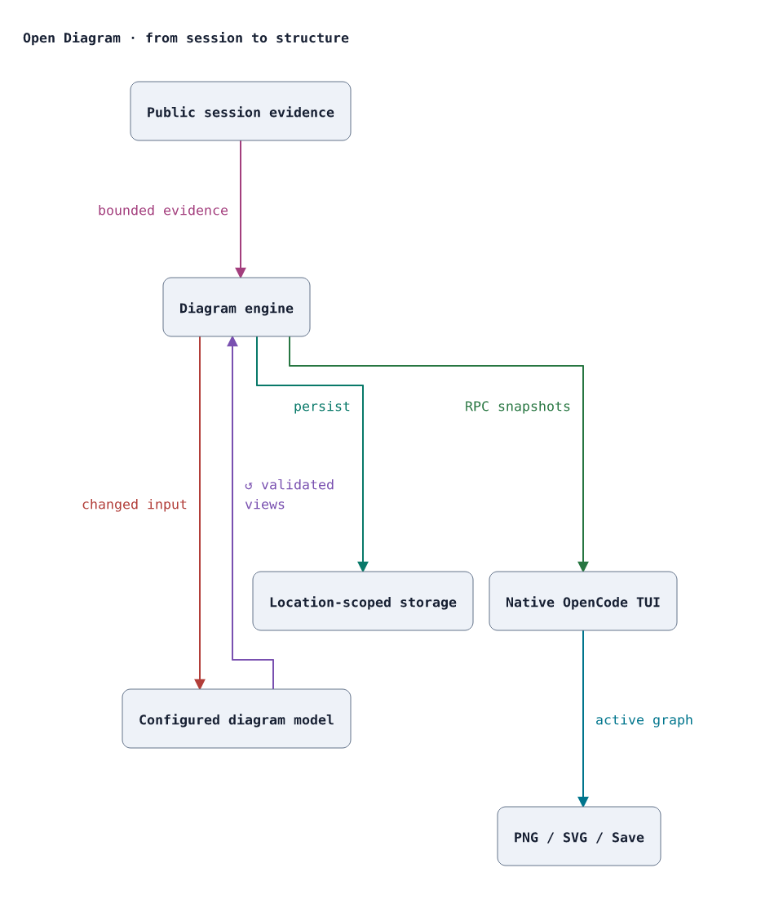
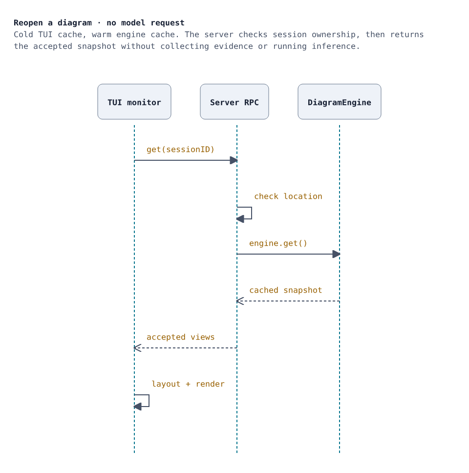
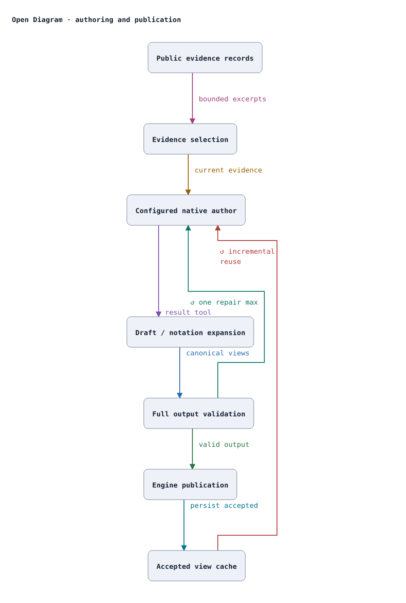

# Open Diagram

**Keep the architecture in view while you build.**

Open Diagram turns software, hardware, and firmware structures into validated
diagrams. Use a **native OpenCode V2 panel**, connect another AI client through
the **standalone MCP server**, or embed the **Node API** in your own application.

Follow a software pipeline, inspect a state machine, trace a hardware interface,
or map a circuit's pins and nets. Keep structured graph JSON for your own
visualization, or render clean SVG and PNG images. Validation and rendering do
not call a model; you choose who authors the diagram.

| Integration | Best for | What you get |
| --- | --- | --- |
| [Standalone MCP](#standalone-mcp-no-opencode-required) | Other AI clients and MCP-enabled services | Client-authored diagrams, JSON tools/resources, SVG/PNG output; local stdio, memory-only storage |
| [Node API](#node-api-for-applications) | Custom services and visualizations | Shared schemas, citation validation, layout, SVG/PNG functions; your app owns inputs and storage |
| [OpenCode plugin](#opencode-plugin-setup) | Keeping architecture beside development work | Native interactive TUI, session evidence, optional automatic authoring, durable cached diagrams |

<picture>
  <source media="(prefers-color-scheme: dark)" srcset="docs/images/architecture-dark.png">
  
</picture>

*The OpenCode integration, drawn with Open Diagram. This hand-authored,
source-linked view uses the shared production exporter—not a terminal screenshot.
[SVG](docs/images/architecture-light.svg)
· [How these images are generated](docs/images/README.md)*

## Why use it?

- **Works beyond OpenCode.** MCP clients publish diagrams using their own model
  and context. Other applications can consume graph JSON or reuse the Node API.
- **Context stays visible in OpenCode.** Separate views for distinct structures;
  select a block for its description, behavior, and source references. Authoring prioritizes
  the parent's active objective over supporting research, audit, or recovery work.
  Explicitly requested workflows, tests, and instructions can be subjects too.
- **Software and hardware belong together.** Architecture, flowcharts, state
  machines, classes, ER models, sequences, timing, and circuits have typed semantics.
- **You choose the author.** Bring a diagram from any capable client or author it
  in OpenCode with your active agent, a dedicated model, or an OpenAI-compatible
  endpoint. No implicit paid fallback.
- **Viewing is local.** Switching views, resizing, selecting, and exporting never
  call a model. The OpenCode plugin persists accepted diagrams and tracking
  preferences; the standalone MCP store lasts only for its process.
- **Updates need not start over in OpenCode.** Reuse unchanged views and node content. Native
  authoring supports compact drafts and one bounded validation repair; failed
  updates leave the last valid diagram visible.
- **It feels like OpenCode.** Native sidebar, keyboard navigation, resizable
  panel, fullscreen, host-theme colors, and one-click Classic sidebar restoration.

## Install and set up

All integrations use **Node.js 22+** and a local checkout. The repository is still
marked `private` for npm publication; do not assume a registry package exists.

```sh
git clone https://github.com/clay-m-smith/open-diagram.git
cd open-diagram
npm ci
pwd
```

Keep the absolute path printed by `pwd`. On Windows, use an absolute path with
forward slashes in JSON, such as `C:/projects/open-diagram`.

### Standalone MCP: no OpenCode required

Configure your MCP client to launch:

```sh
node /absolute/path/to/open-diagram/mcp.mjs
```

For clients using an `mcpServers` configuration object:

```json
{
  "mcpServers": {
    "open-diagram": {
      "command": "node",
      "args": ["/absolute/path/to/open-diagram/mcp.mjs"]
    }
  }
}
```

Configuration file locations and keys vary by host. The launcher waits for MCP
messages on stdin; it does not open a web page or listen on a network port.

Ask the connected client:

> Call `diagram_schema`, then author a diagram from the context I provide. Publish
> it with `diagram_publish`, a diagram ID, `expectedRevision: 0`, and matching
> source references. Render its overview view as PNG with `diagram_render`.

`diagram_get` returns accepted JSON; `diagram_list` discovers diagrams and views;
`diagram_remove` frees a record. JSON is also available through MCP resources.
Updates require the current revision, so stale or invalid submissions do not
overwrite accepted diagrams. Rendering returns an embedded SVG resource or PNG
image, with display support determined by your client.

**First-version boundary:** local stdio, up to 32 diagrams, memory-only storage.
Each server process has its own store. No OpenCode connection, secondary model,
automatic source-file reads, HTTP hosting, or shared persistent service.

See the **[complete standalone guide](docs/standalone.md)** for tool arguments,
publication examples, resource URIs, limits, and troubleshooting.

### Node API for applications

Import `open-diagram/core` to reuse `GraphSchema`, `validateDiagramOutput`,
`layoutDiagram`, `renderDiagramSVG`, and `renderDiagramPNG`. Your app supplies the
data and owns persistence or delivery to its visualization. No MCP connection or
OpenCode runtime is required.

This is a TypeScript source entrypoint for Node-side use, not a browser bundle.
Use a TypeScript-aware runtime such as `node --import tsx your-script.ts`.
[Node API example and exports](docs/standalone.md#use-the-shared-node-api).

## OpenCode plugin setup

Requires **OpenCode 2.x (`>=2.0.27 <3`)** in addition to the checkout above.
Current full verification used **OpenCode 2.0.27**. The range admits later 2.x
releases; it does not claim every future release has already been tested. The
host supplies the plugin/Effect peer runtime; local development pins match
2.0.27. See [setup](docs/setup.md) for dependency compatibility and troubleshooting.

### 1. Load it in your project

Add this entry to the **target project's** `opencode.json` or `opencode.jsonc`.
Merge it into existing `plugins`; do not replace your other settings.

```json
{
  "$schema": "https://opencode.ai/config.json",
  "plugins": [{
    "package": "/absolute/path/to/open-diagram",
    "options": { "backend": "manual" }
  }]
}
```

Open OpenCode in that target project. For an already running instance, reload
configuration with `opencode reload` from the target project and reopen the TUI
if its plugin entry has not appeared. The native **Classic sidebar** is selected
by default, with diagram tabs still available. Click a diagram tab or run
`/open-diagram` to open the diagram view.

### 2. Choose the model that draws your diagrams

| Mode | Who authors the diagram? | What to configure |
| --- | --- | --- |
| **Manual** (default) | Your active agent or an external author, via snapshot/publish tools | `backend: "manual"` |
| **OpenCode model** | A dedicated model available in your target project's OpenCode catalog | `backend: "opencode"`, `providerID`, `model`; optional `variant` |
| **Compatible endpoint** | A model served by a local or explicitly allowed remote API | `backend: "openai-compatible"`, `baseURL`, `model` |

#### Dedicated OpenCode model

For automatic diagrams, connect the provider in OpenCode using `/connect`, then
inspect the available catalog with `opencode models` from the target project.
Use real IDs from that catalog—not a guessed model name. For **GPT-6 Luna**
through OpenAI (`openai/gpt-6-luna`), replace the manual entry's options with:

```json
{
  "backend": "opencode",
  "providerID": "openai",
  "model": "gpt-6-luna"
}
```

**These are plugin options, not OpenCode's top-level `model` setting.** They select
only the diagram author; your chat, agent, and worker routing stay unchanged.
This is an opt-in setup example, not a paid installation default. If your catalog
uses another provider or model, substitute its exact IDs.
Credentials come from OpenCode. Automatic generation can incur provider charges.
Choose a model that reliably submits structured tool arguments and understands
the domain you are diagramming; no particular provider or model is required.
Split catalog `provider/model` at the **first slash**. To select a supported
variant, add `"variant": "YOUR_VARIANT_ID"` separately—do not append it to `model`.

#### Local or remote OpenAI-compatible endpoint

Already serving a model? Replace the same plugin entry's `options` with:

```json
{
  "backend": "openai-compatible",
  "baseURL": "http://127.0.0.1:8082/v1",
  "model": "YOUR_SERVED_MODEL_ID",
  "responseFormat": "json-schema"
}
```

The service must support `POST /chat/completions` and the selected response format.
Use the API root in `baseURL`, not the full request URL. If JSON Schema is not
supported, use `"responseFormat": "json-object"`; local validation still applies.
The plugin does not download or host the model.

For authentication, add `"apiKeyEnv": "DIAGRAM_API_KEY"` and set that variable in
the **OpenCode server's environment** before starting it. Never put keys in JSON,
URLs, or committed files. Remote endpoints also require `"allowRemote": true`;
prefer HTTPS. This sends bounded session excerpts to that service. `providerID`
and `variant` apply only to the OpenCode backend, not this endpoint adapter.

#### Active-agent authoring

Keep `"backend": "manual"` to use your current agent and its current model. There
is no secondary diagram-model request and no automatic paid fallback. Use the
snapshot/publish prompt below; primary-agent usage still follows your provider's
pricing.

See the **[numbered setup and model-selection guide](docs/setup.md)** for exact ID
splitting, variants, local/remote endpoints, credentials, switching models, cost
controls, and troubleshooting.

### 3. Create your first diagram

Have the agent inspect the relevant source files or discuss the design. With an
automatic backend, meaningful development activity can schedule an update; use
**Refresh** to recollect evidence explicitly. Unchanged input reuses accepted output.

In manual mode, ask your agent:

> Inspect the relevant source files. Call `open_diagram_snapshot`, follow its
> instruction and output schema, then call `open_diagram_publish` with a grounded
> diagram of this project. Use separate views where useful.

Manual means **no secondary diagram-model call**, not free primary-agent usage.
The exact [diagram publication procedure](docs/setup.md#publish-a-diagram) works
with any capable model. Refresh alone does not author diagrams in manual mode.

## Eight notation families, one workspace

| Family | What it preserves |
| --- | --- |
| Architecture | Nested groups, named ports, typed links, directional or bidirectional interfaces; useful for software, embedded systems, and HIL rigs |
| Flowchart | Decisions, conditions, start/end roles, fork/join structure |
| State | Initial/final states, composite groups, events, guards, actions |
| Class | Typed fields and methods, visibility, relationship kinds and cardinalities |
| ER | Entities, primary/foreign keys, relationships and cardinalities |
| Sequence | Ordered lifelines and messages, replies, self-calls, activations, labelled interaction spans |
| Timing | Digital `0/1/X/Z` and bus values with exact transition times; event-spaced, explicitly **not to scale** |
| Circuit | Component references and values, numbered pins, scoped multi-terminal nets, NC/unassigned pins, explicit junctions |

Existing block graphs remain supported. Specialized families add validated
structure rather than relying on descriptive labels to imply meaning. These are
compact native notations, not exhaustive UML/IEC drawings or a CAD editor.

<picture>
  <source media="(prefers-color-scheme: dark)" srcset="docs/images/cached-view-dark.png">
  
</picture>

*A second view of this repository: reopening a cached diagram. The same accepted
data feeds the terminal and exports. [SVG](docs/images/cached-view-light.svg)*

## Native OpenCode controls

| Action | Control |
| --- | --- |
| Open diagrams | `/open-diagram` |
| More room | `/open-diagram panel` or `/open-diagram fullscreen` |
| Change detail | **Overview / Granular**, or `/open-diagram overview` / `granular` |
| Track changes | **Pause / Resume / Refresh** |
| Navigate a focused panel | `j/k` select, `f` fullscreen, `p` pause/resume, `r` refresh |
| Restore OpenCode's sidebar | **Classic sidebar**, `/open-diagram sidebar`, or panel `Escape` |
| Share a diagram | **PNG / SVG / Save** |

Descriptions and **Sources** stay separate. Wide diagrams scroll rather than
clip; layout and navigation respect each family's structure. **Granular** shows
internals present in the evidence, not invented implementation detail.

Exports include the full active diagram, not terminal chrome. They follow the
host's light/dark mode by default, with a persistent **export-only** theme override.
Linux image clipboard support uses existing `wl-copy` or `xclip`; unsupported
environments get a Save fallback. Save refuses existing files and symlinks.

Read the [usage and export guide](docs/usage.md) for controls, caching behavior,
SSH clipboard requirements, and rendering limits.

## Under the hood

The shared core owns graph/notation schemas, validation, layout, and image
rendering. The OpenCode adapter owns session evidence, configured generation,
and durable state; its TUI owns presentation. The standalone MCP adapter accepts
client-authored diagrams and owns a bounded in-memory store, without importing
the OpenCode runtime. The Node API exposes the core directly.

Generic graph layout uses pinned ELK.js in an isolated worker; sequence, timing,
and circuit views use deterministic family-specific geometry. All integrations
reuse these local layouts and exporters.

Evidence selection retains the parent's meaningful objective and reserves bounded
space for subject and supporting evidence. Worker facts can support that objective;
worker objectives do not replace it. Selection is local and heuristic, with no
extra model calls or exhaustive semantic verification. Meaningful objective
changes invalidate cache reuse even when source bytes are unchanged.
Completed public compaction summaries retain historical project context, not
proof of implementation. Native authoring uses an isolated managed session with
request-local evidence, restricted permissions, and a result tool. It expands compact drafts or sparse
updates into canonical graphs, then validates structure, references, citations,
and budgets before anything replaces an accepted view.

<details>
<summary><strong>See this repository's authoring and publication pipeline</strong></summary>

<picture>
  <source media="(prefers-color-scheme: dark)" srcset="docs/images/authoring-dark.png">
  
</picture>

*Hand-authored from this repository's sources, rendered by the production
exporter. Arrows show data and feedback, not a complete call graph.
[SVG](docs/images/authoring-light.svg) · [Source map](docs/images/README.md)*

</details>

- [Server and public RPC](src/diagram/server.ts)
- [Standalone MCP server](src/standalone/server.ts) and [bounded store](src/standalone/store.ts)
- [Host-independent Node API](src/core.ts) and [shared graph schemas](src/diagram/model.ts)
- [Engine and durable caches](src/diagram/engine.ts)
- [Native author and validation repair](src/diagram/client.ts)
- [Versioned notation contracts](src/diagram/notation-schema.ts)
- [Shared layout](src/diagram/layout.ts) and [specialized geometry](src/diagram/notation-layout.ts)
- [Model-independent authoring harness](docs/harness.md)

## Develop and publish

```sh
npm ci
npm run verify       # TypeScript + unit, MCP, native TUI, and isolated runtime checks
node --import tsx --test tests/standalone.test.ts  # Standalone-only checks
npm run docs:images  # Regenerate this README's light/dark SVG and PNG images
npm run docs:check   # Check SVG freshness and PNG signatures/dimensions
npm pack --dry-run   # Inspect the package file list; does not publish
```

Native runtime tests require OpenCode **2.0.27–2.0.x** and `python3` on PATH;
the existing harness rejects 2.1.x even though the package's host range is broader.
Standalone tests do not need OpenCode. The native renderer test
needs Node **26.4+** with `--experimental-ffi`; it skips on older Node versions.
Tests use isolated fixture services, never paid models or the shared service.

The **[maintainer publishing guide](docs/publishing.md)** enumerates verification,
Git push, package preparation, npm publication, and consumer configuration.
Pushing Git does **not** publish to npm or change repository visibility.

## Trust and limits

Diagrams are interpretations, not proof of correctness or an exhaustive scan.
Standalone clients supply graph content and source references: validation checks
structure and reference consistency, not the truth of their claims. MCP records
are private to the launched process but readable by its caller; they disappear on
exit. Export or retain JSON in your application when durability matters.

The OpenCode plugin uses bounded public session evidence. Read relevant files
into the session; image-only schematics and omitted declarations cannot be
reconstructed. Automatic backends receive those excerpts, so avoid admitting secrets.

Failed updates retain the last valid diagram with a visible warning. Accepted
graph text and citation labels persist in location-scoped plugin storage; source
excerpts are transient. Open Diagram does not read another plugin's private state
or change host model routing or theme settings.

Cold generation depends on the configured model and can take tens of seconds or
time out. Native generation and at most one repair share `timeoutMs` (default
90 seconds); a repair does not restart the clock. There is no provider fallback.

Circuit connectivity comes from explicit pins and nets—not crossing lines.
PCB placement/routing, CAD import adapters, simulation, ERC/DRC, manufacturing
outputs, and electrical-safety certification are outside Open Diagram's scope.
